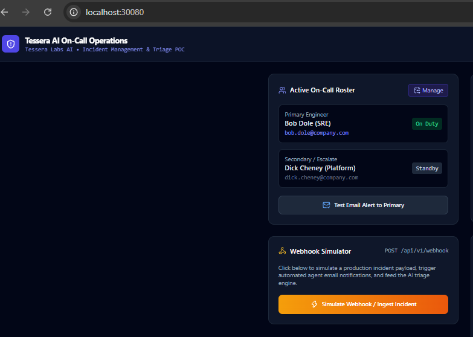
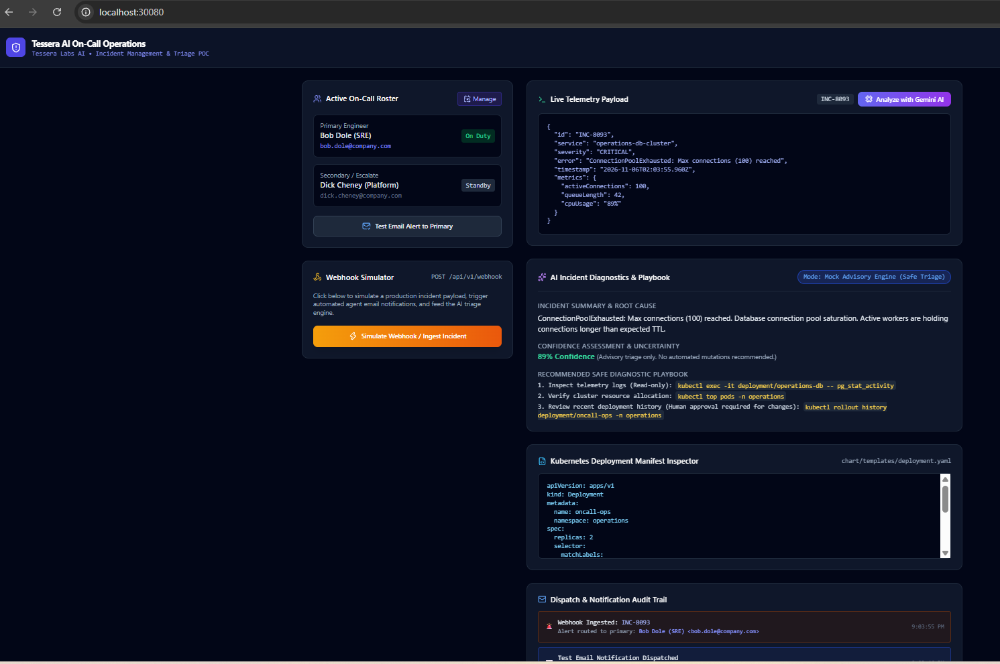
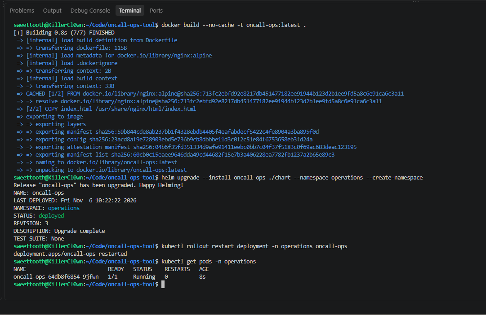

# AI On-Call Operations Console (Tessera Labs)

An enterprise-grade, zero-dependency AI On-Call Operations & Automated Incident Remediation platform featuring real-time incident management, simulated webhook ingestion, automated engineer notification dispatching, and Gemini AI root-cause diagnostic playbooks.

---

## Project Structure

```text
oncall-ops-poc/
├── docs/                   # Helm chart deployment package
│   └── screenshots/
│       ├── 1-cluster-deployment.png            # Image of container build, deployment and pod running   
│       ├── 2-dashboard-OC.png                  # Image of the OC rotation
│       └── 3-indicent-ai.triage.png            # Image of Webhook alert with Gemini recommended action
│       └── 4-k8s-manifest-inspector.png        # Image of k8s deployment, service and namespace configuration
│       └── demo.mp4            # Demo video of installation and navigation - Download as RAW file since GH only supports up to 50MB
├── chart/                   # Helm chart deployment package
│   ├── Chart.yaml
│   ├── values.yaml
│   └── templates/
│       ├── deployment.yaml
│       └── service.yaml
├── Dockerfile               # Nginx container definition
├── Architecture.md          # Architecture and data flow diagram for Application 
├── azure-pipelines.yml      # CI/CD pipeline definition for Azure AKS
├── index.html               # Single-file React & Tailwind application
├── PRD.md                   # Product Requirements Document (PRD) providing detailed objectives of Application
└── README.md                # Project documentation
```

## Local Deployment

Utilizing Rancher-Desktop and Helm for local validation testing. End-User can use their choice of local kubernetes environment. First verify your local instance is actively running and you are directed to your local Kubernetes Cluster (.kube directory). User will then clone repository and then, from the root directory, user simply can run:
```
docker build -t oncall-ops:latest .
helm upgrade --install oncall-ops ./chart --namespace operations --create-namespace
```
After install, user can run following command to verify pod is running:
```
kubectl get pods -n operations #There should be 1 pod running
```
User can now open a web browser of their choosing and navigate to:
localhost:30080

Gotchas during initial implementation
1. Docker container build had cached image, run following to clear cache and ensure full new build.
```
docker build --no-cache -t oncall-ops:latest .
```
2. With new image, pod was not instantly refreshing the changes.
```
kubectl rollout restart deployment/oncall-ops-n operations
```

## Evidence of Successful Run

### On Call Roster


### Incident Ingestion & AI Triage Playbook


### Terminal & Kubernetes Deployment


### Video Walkthrough
A short video demonstration of the incident dispatch and AI triage workflow is available at [`docs/demo.mp4`](docs/demo.mp4).

---

## Assumptions, Trade-offs & Security

### Architectural & Operational Assumptions
* **Single-Page Application Scope:** Built as a standalone Nginx container serving a zero-friction React/Tailwind frontend to eliminate external backend database setup requirements for local evaluation.
* **Cluster Access:** Assumes local access to a k3s/Rancher Desktop cluster with default storage and networking drivers.

### Security Awareness
* **Secret Management:** Sensitive credentials (such as Azure Service Principals and API keys) are injected dynamically via Azure DevOps Pipeline secrets / Kubernetes Secrets rather than stored in repository files.
* **RBAC & Isolation:** The application deploys to a dedicated `operations` namespace to ensure workload isolation and apply strict Role-Based Access Control (RBAC).
* **Ingress Security:** Local deployment uses NodePort for simplicity; production AKS deployment expects SSL/TLS termination at the ingress controller (NGINX, Traefik, Istio, etc.).

### Observability & Future Enhancements
* **Metrics & Logging:** Production deployments should integrate Prometheus metrics (`/metrics`) and structured JSON logs forwarded to Azure Log Analytics or Datadog.
* **Persistent Storage:** Incident history currently operates in-memory for the POC; production architecture should back this with an enterprise datastore (e.g., PostgreSQL / Azure Cosmos DB / Longhorn (RKE2)).

## Cleanup and Uninstall

When done with POC, user can issue following commands to fully uninstall the application and associated resources
```
helm uninstall oncall-ops -n operations
```

Verify all resources are gone by running
```
kubectl get all -n operations
```

If user wants to completely remove the "operations" namespace, run the following (needs to be done since the namespace creation was done at the helm chart install)
```
kubectl delete namespace operations
```